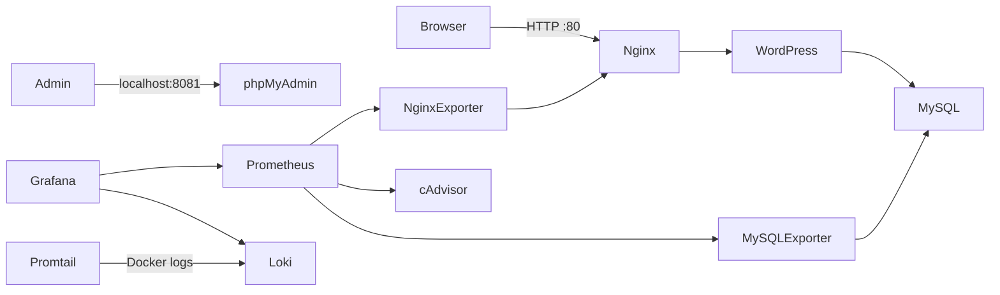

# Website quảng bá sản phẩm WordPress

Bộ mã triển khai đề tài WordPress bằng Docker Compose: website giới thiệu sản phẩm, MySQL/phpMyAdmin, Nginx reverse proxy, Prometheus/Grafana và Loki/Promtail. Giao diện WordPress được cung cấp bởi theme `quangba`, có loại nội dung **Sản phẩm**, ảnh đại diện và trường giá VND.

> Trước khi nộp, hoàn thiện thông tin giảng viên/trường và ảnh chụp trong [báo cáo](docs/BAO-CAO.md). Repository GitHub của sinh viên: [WebsiteQUANGBASANPHAM-WordPress-](https://github.com/sungthai/WebsiteQUANGBASANPHAM-WordPress-).

## Kiến trúc



`frontend`, `backend`, `observability` là các Docker network riêng. MySQL không publish cổng ra máy chủ; phpMyAdmin, Grafana và Prometheus chỉ bind vào loopback. Nginx là điểm vào duy nhất cho website.

## Đối chiếu yêu cầu và trạng thái

| Yêu cầu | Phần đã chuẩn bị | Việc còn cần xác nhận |
|---|---|---|
| Source, cấu hình, README, GitHub và 3 commit | Mã nguồn, Compose, cấu hình dịch vụ và README có trong thư mục | Tạo GitHub account/repository theo MSSV, push và tạo 3 commit |
| WordPress + MySQL + phpMyAdmin | Theme sản phẩm, DB, phpMyAdmin và quy trình setup đã cấu hình | Khởi chạy Docker, tạo sản phẩm và chụp ảnh kết quả |
| Nginx reverse proxy | Nginx proxy và security headers đã cấu hình | Xác nhận website/header trên máy đang chạy |
| Prometheus + Grafana | Exporters, cấu hình scrape và dashboard provision sẵn | Xác nhận Targets UP và dashboard có dữ liệu |
| Loki + Promtail + LogQL | Pipeline log và 3 truy vấn mẫu đã cấu hình/ghi tài liệu | Xác nhận log thực tế xuất hiện trong Explore |
| Hardening | Network cô lập, secret, hạn chế port/quyền và security headers đã cấu hình | Kiểm tra runtime và trình bày ảnh minh chứng |
| Báo cáo tối thiểu 10 trang | Bản thảo Markdown và HTML để in PDF | Điền thông tin sinh viên, chèn ảnh thật, in PDF và kiểm tra số trang |

**Lưu ý trạng thái:** đây là các cấu hình đã chuẩn bị, không phải bằng chứng rằng dịch vụ đã chạy. Docker Engine hiện cần khởi động thành công và phải xác nhận bằng `docker compose ps`, giao diện web, Prometheus Targets và Grafana Explore.

## Yêu cầu

- Docker Desktop/Engine hỗ trợ Docker Compose v2.
- Nên có ít nhất 15 GB dung lượng trống trong ổ lưu Docker Desktop. Nếu ổ C gần đầy: mở **Docker Desktop → Settings → Resources → Advanced → Disk image location**, chọn thư mục trên ổ D (ví dụ `D:\DockerData`), nhấn **Apply & Restart**, đợi Docker báo Engine đang chạy rồi xác minh bằng `docker version` (phải có cả Client và Server). Không tự cắt/xóa file dữ liệu WSL/Docker.
- Cổng 80, 3000, 8081 và 9090 chưa được ứng dụng khác sử dụng.
- Với Linux, tài khoản chạy Docker cần quyền đọc Docker log directory. Docker Desktop trên Windows cung cấp Docker daemon Linux thông qua máy ảo.

## Chạy lần đầu

Mở PowerShell tại thư mục dự án:

```powershell
.\scripts\new-secrets.ps1
```

Script tạo `.env` với mật khẩu ngẫu nhiên riêng cho từng dịch vụ. Không đưa `.env` lên GitHub. Đặt `WORDPRESS_SITE_URL=http://localhost` khi truy cập tại máy hiện tại; đổi giá trị này nếu dùng hostname riêng. Nếu đã có `.env`, script không ghi đè.

```powershell
docker compose config --quiet
docker compose up -d
docker compose ps
docker compose logs -f wordpress-setup
```

Có thể khởi động kèm kiểm tra file secret và Docker Engine bằng:

```powershell
.\scripts\start.ps1
```

Lần đầu MySQL tạo database/user và tài khoản exporter, sau đó `wordpress-setup` cài WordPress, tạo tài khoản quản trị và kích hoạt theme. Chờ `wordpress-setup` kết thúc thành công trước khi đăng nhập. Mở:

| Thành phần | URL | Đăng nhập |
|---|---|---|
| Website | http://localhost | Xem website công khai |
| WordPress Admin | http://localhost/wp-admin | `WORDPRESS_ADMIN_USER` và `WORDPRESS_ADMIN_PASSWORD` trong `.env` |
| phpMyAdmin | http://localhost:8081 | Chọn máy chủ `db`, user `root` hoặc `MYSQL_USER` và mật khẩu tương ứng |
| Grafana | http://localhost:3000 | `GRAFANA_ADMIN_USER` và `GRAFANA_ADMIN_PASSWORD` |
| Prometheus | http://localhost:9090 | Chỉ phục vụ kiểm tra tại máy local |

phpMyAdmin mặc định cho phép truy cập cục bộ từ máy triển khai. Không expose cổng 8081 ra Internet. Grafana/Prometheus cũng chỉ bind `127.0.0.1`; khi chạy trên máy chủ từ xa, dùng SSH tunnel thay vì mở trực tiếp các cổng quản trị.

## Thêm sản phẩm

1. Đăng nhập `/wp-admin`.
2. Mở **Sản phẩm → Thêm sản phẩm**.
3. Nhập tên, mô tả, giá (chỉ nhập số VND), trích đoạn và ảnh đại diện, sau đó **Đăng**.
4. Trang chủ tự hiển thị tối đa 9 sản phẩm mới nhất. Đường dẫn danh mục là `/san-pham/`.

Theme nằm trong `wordpress/themes/quangba`; theme được mount chỉ đọc vào WordPress. Thay đổi PHP/CSS được cập nhật khi tải lại trang.

## Giám sát

- Grafana tự cấu hình Prometheus và Loki làm data source. Dashboard **WordPress Infrastructure** được nạp tự động.
- Prometheus thu thập mỗi 15 giây: trạng thái Prometheus, số liệu Nginx (`nginx-exporter`), MySQL (`mysqld-exporter`) và container (`cAdvisor`).
- Mở **Grafana → Dashboards → WordPress Stack → WordPress Infrastructure** để xem CPU/RAM container, kết nối Nginx, kết nối MySQL và trạng thái scrape.
- Docker Desktop có thể không cung cấp đầy đủ số liệu cAdvisor như Docker Engine Linux; kiểm tra `http://localhost:9090/targets` và trạng thái target `containers`.

## Log tập trung và LogQL

Promtail khám phá Docker container qua Docker socket proxy giới hạn quyền đọc danh sách container/events; log được lưu trong Loki 7 ngày. Trong Grafana chọn **Explore → Loki** và chạy các truy vấn:

```logql
{service="nginx"}
{service="wordpress"} |= "error"
{container=~".*mysql.*"} |~ "(?i)(error|warning)"
```

Tên service/nhãn phụ thuộc nhãn Compose của container. Có thể xác nhận các nhãn đang có bằng cách mở Explore, chọn Loki và dùng nút **Label browser**. Không thu thập log của Loki/Promtail/socket proxy để tránh vòng lặp.

## Hardening đã áp dụng

- Network backend và observability đặt `internal: true`; MySQL không publish port.
- phpMyAdmin, Grafana, Prometheus chỉ bind loopback; không cho Grafana anonymous access và tắt đăng ký người dùng.
- Mật khẩu được lấy từ `.env`, file này bị Git ignore; user exporter riêng chỉ có quyền đọc metric cần thiết.
- Nginx có các security header, tắt lộ phiên bản, chỉ mở cổng HTTP 80; cấu hình read-only filesystem, bỏ capability không cần và chỉ thêm `NET_BIND_SERVICE`.
- Các service bật `no-new-privileges`; giới hạn bộ nhớ cho các service nặng.
- Promtail không mount trực tiếp Docker socket; Docker API chỉ đi qua socket proxy với `POST=0` và các endpoint đọc được giới hạn.
- WordPress tắt sửa file mã nguồn từ Dashboard; theme mount read-only.

Ảnh Docker chính thức của WordPress/MySQL cần entrypoint tương thích để khởi tạo dữ liệu và quyền file. Vì vậy không ép `user:` cho các ảnh đó; Apache worker chạy dưới tài khoản `www-data`, MySQL chuyển sang tài khoản dịch vụ sau khởi tạo. Không chạy stack này như một cấu hình production public mà chưa bổ sung TLS, bảo vệ đường dẫn quản trị, backup, cập nhật ảnh và kiểm thử bảo mật.

## HTTPS tùy chọn

Security headers trên Nginx đáp ứng phương án HTTP trong bài. Nếu cần minh họa HTTPS tự ký, tạo certificate cục bộ bằng OpenSSL, cấu hình thêm listener `443 ssl` và mount certificate/key read-only vào Nginx. Không commit khóa riêng lên GitHub; `*.key`, `*.pem`, `*.crt` đã nằm trong `.gitignore`. Browser sẽ cảnh báo với certificate tự ký.

## Dừng, cập nhật và dữ liệu

```powershell
docker compose down
docker compose pull
docker compose up -d
```

`docker compose down` giữ lại volume dữ liệu. **Không dùng `docker compose down -v` trừ khi chấp nhận xóa website, database, dashboard đã lưu và log**. Sao lưu database trước khi bảo trì:

```powershell
docker compose exec -T db sh -c 'exec mysqldump -uroot -p"$MYSQL_ROOT_PASSWORD" "$MYSQL_DATABASE"' > wordpress-backup.sql
```

## GitHub và ba mốc commit

Repository theo thông tin sinh viên: [sungthai/WebsiteQUANGBASANPHAM-WordPress-](https://github.com/sungthai/WebsiteQUANGBASANPHAM-WordPress-). Sau khi xác nhận repository rỗng hoặc đã sao lưu nội dung hiện có, cấu hình remote và chia thay đổi thành ba mốc:

1. `feat: deploy WordPress behind hardened Nginx with MySQL`
2. `feat: add Prometheus and Grafana monitoring`
3. `feat: add Loki Promtail centralized logging`

Không push đè lên nhánh đã có lịch sử mà chưa kiểm tra. Các commit chỉ được tạo sau khi xác nhận danh tính Git author và lịch sử remote. Kiểm tra trước khi push:

```powershell
git status
git check-ignore .env
docker compose config --quiet
```

Không commit `.env`, thông tin đăng nhập, database dump, certificate/private key.

## Xuất báo cáo

Sau khi điền thông tin sinh viên và chèn ảnh minh chứng vào `docs/BAO-CAO.md`, tạo bản HTML để in:

```powershell
node .\docs\export-report.js
```

Mở `docs/BAO-CAO.html` bằng Edge/Chrome, chọn **Print → Save as PDF**, khổ A4 và bật headers/footers. Kiểm tra bản PDF có ít nhất 10 trang, trang bìa, ảnh minh chứng và không còn placeholder trước khi nộp. Không coi các vị trí `[CHÈN ẢNH]` là ảnh minh chứng.

## Demo và minh chứng báo cáo

Chụp ảnh màn hình sau khi chạy hệ thống, lưu vào `docs/images/` rồi chèn vào [báo cáo](docs/BAO-CAO.md): trang sản phẩm, phpMyAdmin thấy bảng WordPress, dashboard Grafana, Prometheus Targets, 2–3 truy vấn LogQL và kết quả hardening (`docker compose ps`, network/port). Ảnh cần là kết quả chạy thật, không dùng ảnh minh họa thay kết quả.
