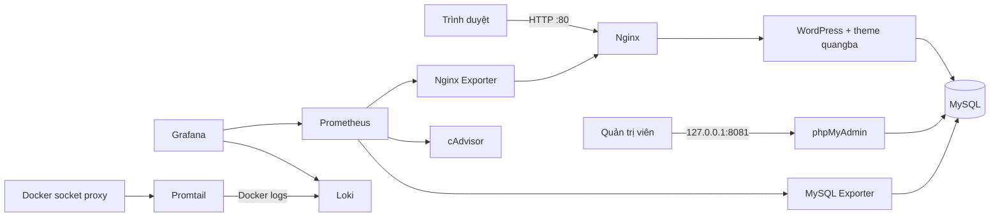

# BÁO CÁO ĐỀ TÀI

## TRIỂN KHAI VÀ QUẢN TRỊ HỆ THỐNG PHẦN MỀM

### WEBSITE QUẢNG BÁ SẢN PHẨM WORDPRESS BẰNG DOCKER COMPOSE

**Sinh viên thực hiện:** Sùng A Thái  
**Mã số sinh viên:** DTC245200934  
**Lớp:** CNTT  
**Ngành:** CNTT  
**Giảng viên hướng dẫn:** [GIẢNG VIÊN]  
**Trường/Khoa:** [TÊN TRƯỜNG - KHOA]  
**Địa điểm, năm:** Thái Nguyên, 2026

> Trước khi nộp: điền các trường trong ngoặc vuông, chèn ảnh chụp thật vào các vị trí đánh dấu, chạy `node .\docs\export-report.js`, mở HTML bằng Edge/Chrome và in sang PDF khổ A4. Kiểm tra bản PDF có tối thiểu 10 trang, bìa, mục lục, ảnh và định dạng trước khi nộp.

\newpage

## LỜI MỞ ĐẦU

Website giới thiệu sản phẩm là một thành phần quan trọng trong hoạt động cung cấp thông tin, tiếp cận khách hàng và trình bày danh mục hàng hóa. Bên cạnh việc xây dựng giao diện, hệ thống triển khai cần có cơ sở dữ liệu ổn định, đường truy cập có kiểm soát, công cụ quản trị và khả năng quan sát khi có lỗi. Đề tài này xây dựng một môi trường hoàn chỉnh cho website quảng bá sản phẩm sử dụng WordPress, MySQL và các công cụ mã nguồn mở.

Toàn bộ thành phần được khai báo trong Docker Compose để quá trình dựng môi trường có thể lặp lại trên máy cá nhân hoặc máy chủ Linux. Nginx tiếp nhận kết nối web và chuyển tiếp yêu cầu đến WordPress. MySQL lưu trữ nội dung, tài khoản và cấu hình; phpMyAdmin hỗ trợ thao tác quản trị database. Prometheus thu thập số liệu, Grafana hiển thị dashboard, còn Loki và Promtail tập trung log container để truy vấn bằng LogQL.

Mục tiêu thực hành không chỉ là khởi động được nhiều container mà còn hiểu luồng dữ liệu, ranh giới network, giới hạn của image chính thức và cách xác minh kết quả. Hệ thống áp dụng mật khẩu riêng qua file môi trường, cô lập database khỏi cổng công khai, giới hạn truy cập giao diện quản trị, thêm security headers và giảm quyền cho các tiến trình phù hợp.

**Phạm vi:** phiên bản này phục vụ học tập và demo trong môi trường local. Hệ thống chưa được xem là cấu hình production Internet-facing: cần bổ sung tên miền, TLS tin cậy, backup ngoài máy, kiểm thử tải, giám sát cảnh báo và quy trình cập nhật/khôi phục trước khi đưa vào sử dụng thật.

### Mục lục

1. Tổng quan đề tài và yêu cầu
2. Thiết kế kiến trúc
3. Triển khai ứng dụng WordPress và database
4. Reverse proxy Nginx và security headers
5. Giám sát Prometheus và Grafana
6. Tập trung log Loki, Promtail và LogQL
7. Hardening và phân tích rủi ro
8. Kiểm thử, kết quả và minh chứng
9. Quản lý mã nguồn, vận hành và hạn chế
10. Kết luận

\newpage

## 1. TỔNG QUAN ĐỀ TÀI VÀ YÊU CẦU

### 1.1. Mục tiêu

Đề tài triển khai website quảng bá sản phẩm bằng WordPress trên nền tảng container. Hệ thống cần đáp ứng các mục tiêu:

- Website có trang chủ giới thiệu và khu vực hiển thị danh sách sản phẩm.
- Dữ liệu nội dung được lưu trong MySQL và có phpMyAdmin để quản trị.
- Nginx làm reverse proxy, thêm các HTTP security headers và chuyển tiếp yêu cầu đến web application.
- Prometheus thu thập số liệu Nginx, database và container; Grafana hiển thị dashboard.
- Promtail gửi Docker logs đến Loki và người quản trị có thể truy vấn log bằng LogQL.
- Mã nguồn, cấu hình và hướng dẫn được tổ chức trong một repository, tránh đưa thông tin bí mật vào lịch sử Git.

### 1.2. Phạm vi chức năng

Theme `quangba` đăng ký loại nội dung `san_pham`, hỗ trợ tiêu đề, nội dung, trích đoạn và ảnh đại diện. Mỗi sản phẩm có một trường giá VND; trang chủ hiển thị tối đa chín sản phẩm được xuất bản. Người quản trị tạo và cập nhật nội dung từ WordPress Admin. WordPress CLI chạy trong container khởi tạo giúp cài đặt site và kích hoạt theme sau khi database sẵn sàng.

Các chức năng giám sát tập trung vào trạng thái hạ tầng và dịch vụ. Prometheus lưu time series ngắn hạn; Grafana truy vấn Prometheus và Loki. LogQL cho phép lọc log theo service/container, tìm từ khóa lỗi và đối chiếu sự kiện giữa các dịch vụ.

### 1.3. Công nghệ

| Nhóm | Công nghệ |
|---|---|
| Web/CMS | WordPress official image, PHP 8.2, Apache |
| Database và quản trị | MySQL 8.4, phpMyAdmin 5.2 |
| Reverse proxy | Nginx 1.27 |
| Metrics | Prometheus 2.54, Grafana 11.2, cAdvisor, Nginx Exporter, MySQL Exporter |
| Log | Loki 3.1, Promtail 3.1 |
| Điều phối | Docker Compose v2 |

Các image được chọn theo tag phiên bản cụ thể để cấu hình có thể lặp lại; khi triển khai thật cần cập nhật định kỳ, kiểm tra changelog và lập kế hoạch migration/rollback.

\newpage

## 2. THIẾT KẾ KIẾN TRÚC

### 2.1. Sơ đồ tổng thể



**Hình 1.** Sơ đồ logic các dịch vụ. Khi hoàn thiện báo cáo, nên thay hoặc bổ sung bằng sơ đồ xuất từ Mermaid/Draw.io để thể hiện hostname, port và tên network.

### 2.2. Luồng yêu cầu

Trình duyệt gửi HTTP tới cổng 80 trên máy chạy Compose. Nginx đặt các header chuyển tiếp (`Host`, `X-Real-IP`, `X-Forwarded-For`, `X-Forwarded-Proto`) rồi proxy đến dịch vụ `wordpress` trên network `frontend`. WordPress dùng tên dịch vụ `db` để kết nối cổng 3306 qua network `backend`. Database không publish cổng ra host, do đó client bên ngoài không thể kết nối trực tiếp bằng port mapping.

phpMyAdmin cũng nằm trong network backend nhưng cổng host được bind tại `127.0.0.1:8081`. Điều này cho phép thao tác từ máy triển khai mà không mở công cụ quản trị cho toàn mạng. Prometheus kết nối tới exporter qua network `observability`; các exporter riêng kết nối tới Nginx/MySQL theo network cần thiết.

### 2.3. Network và lưu trữ

Compose định nghĩa ba network bridge. `frontend` cho phép Nginx giao tiếp với WordPress. `backend` và `observability` được khai báo nội bộ, không dùng làm lối truy cập từ bên ngoài. Một số exporter được kết nối đồng thời vào network giám sát và network dịch vụ nhằm thu thập số liệu mà không phải mở cổng MySQL.

Các named volume giữ dữ liệu website, MySQL, Prometheus, Grafana và Loki khi container được thay mới. Cấu hình ứng dụng được bind mount chỉ đọc khi phù hợp. `docker compose down` không xóa volume; lệnh `down -v` sẽ xóa dữ liệu và chỉ được sử dụng khi chủ động làm mới môi trường thử nghiệm.

\newpage

## 3. TRIỂN KHAI WORDPRESS VÀ DATABASE

### 3.1. Khởi tạo bằng Docker Compose

File `docker-compose.yml` mô tả toàn bộ dịch vụ và điều kiện phụ thuộc. MySQL có health check bằng `mysqladmin ping`. WordPress đợi database khỏe trước khi khởi động. Container `wordpress-setup` sử dụng image WordPress CLI, tạo site với thông tin `.env` và kích hoạt theme. File `.env` không được quản lý bởi Git; `.env.example` chỉ ghi tên biến cùng giá trị hướng dẫn.

Các lệnh triển khai:

```powershell
.\scripts\new-secrets.ps1
docker compose config --quiet
docker compose up -d
docker compose ps
docker compose logs -f wordpress-setup
```

Khi cài đặt thành công, truy cập `http://localhost`, đăng nhập quản trị tại `/wp-admin`. Thông tin đăng nhập lấy từ file `.env` cục bộ, không ghi trong báo cáo được chia sẻ công khai.

### 3.2. Quản lý nội dung sản phẩm

Theme tạo menu **Sản phẩm** trong Dashboard. Khi biên tập viên thêm một sản phẩm, họ có thể nhập tiêu đề, mô tả, trích đoạn, ảnh đại diện và giá dạng số. Callback lưu giá kiểm tra nonce, quyền `edit_post`, trạng thái autosave và loại nội dung trước khi ghi metadata. Dữ liệu đầu ra được escape theo ngữ cảnh HTML.

Trang chủ truy vấn tối đa chín sản phẩm trạng thái `publish`; nếu chưa có dữ liệu, giao diện hiển thị hướng dẫn thêm sản phẩm thay vì trang trống. Ảnh đại diện được ưu tiên sử dụng, và phần mô tả được rút gọn cho thẻ sản phẩm. Có thể xác nhận chức năng bằng cách tạo ít nhất ba sản phẩm có ảnh, giá và mô tả khác nhau.

### 3.3. MySQL và phpMyAdmin

MySQL tạo database và người dùng ứng dụng theo biến môi trường. WordPress chỉ đăng nhập bằng user ứng dụng; không dùng root trong kết nối web. Người dùng exporter được tạo bởi script init và chỉ nhận các quyền `PROCESS`, `REPLICATION CLIENT`, `SELECT` cần để đọc số liệu. phpMyAdmin dùng hostname nội bộ `db`, cấm kết nối tới máy chủ tùy ý (`PMA_ARBITRARY=0`).

Các biến đổi script khởi tạo MySQL chỉ được chạy khi volume database còn rỗng. Nếu đổi mật khẩu trên `.env` sau khi database đã khởi tạo, phải cập nhật tài khoản trong MySQL bằng thao tác quản trị tương ứng; thay biến môi trường không tự đổi mật khẩu đã lưu trong database. Sao lưu trước mọi thao tác reset.

### 3.4. Minh chứng cần chèn

**Hình 2.** Trang chủ có danh sách sản phẩm mẫu: `[CHÈN ẢNH CHỤP TRANG WEB TẠI ĐÂY]`  
**Hình 3.** WordPress Admin, danh sách sản phẩm và trường giá: `[CHÈN ẢNH]`  
**Hình 4.** phpMyAdmin hiển thị database và các bảng `wp_*`: `[CHÈN ẢNH]`

\newpage

## 4. NGINX REVERSE PROXY VÀ SECURITY HEADERS

### 4.1. Chức năng proxy

Nginx là điểm vào duy nhất được publish ra cổng host 80. Cấu hình `nginx/default.conf` nhận request ở server web, đặt `client_max_body_size` phù hợp với ảnh sản phẩm và chuyển tiếp tới `http://wordpress:80`. Các header chuyển tiếp giúp ứng dụng phía sau nhận biết host và địa chỉ client. Một server nội bộ trên cổng 8080 cung cấp `stub_status` cho Nginx Exporter; cổng đó không được publish ra host.

### 4.2. Header bảo mật

Nginx bổ sung các header:

- `X-Content-Type-Options: nosniff` hạn chế trình duyệt tự suy đoán kiểu nội dung.
- `X-Frame-Options: SAMEORIGIN` hạn chế nhúng trang từ nguồn khác.
- `Referrer-Policy: strict-origin-when-cross-origin` giảm thông tin referrer gửi ra ngoài.
- `Permissions-Policy` tắt các quyền trình duyệt không cần cho website.
- `server_tokens off` tránh hiển thị phiên bản Nginx trong trang lỗi/header.

Đề tài dùng HTTP kèm security headers để đáp ứng yêu cầu phương án cơ bản. Với môi trường public, cần tên miền, chứng thư TLS đáng tin cậy, redirect HTTP→HTTPS và cấu hình HSTS chỉ sau khi HTTPS hoạt động ổn định. Chứng thư tự ký chỉ phù hợp minh họa; không cung cấp tính xác thực như CA công cộng.

### 4.3. Kiểm tra

```powershell
curl.exe -I http://localhost
docker compose exec nginx nginx -t
```

Kết quả mong đợi: website trả HTTP thành công hoặc chuyển hướng do WordPress; response có các header bảo mật đã cấu hình. Nếu cổng 80 bận, dừng dịch vụ đang chiếm cổng hoặc thay mapping host trong Compose rồi điều chỉnh URL truy cập.

**Hình 5.** Response headers từ Nginx hoặc DevTools Network: `[CHÈN ẢNH CHỤP THẬT]`

\newpage

## 5. GIÁM SÁT PROMETHEUS VÀ GRAFANA

### 5.1. Thu thập metrics

Prometheus đọc cấu hình `prometheus/prometheus.yml`, scrape mỗi 15 giây và lưu dữ liệu tối đa bảy ngày. Các target gồm Prometheus tự giám sát, Nginx Exporter, MySQL Exporter và cAdvisor. Nginx Exporter đọc trang `stub_status`; MySQL Exporter dùng tài khoản `exporter`; cAdvisor cung cấp số liệu CPU/bộ nhớ container. Mỗi exporter được giữ trong network nội bộ thay vì publish cổng ra host.

Mở `http://localhost:9090/targets` để kiểm tra từng target. Trạng thái **UP** có nghĩa Prometheus kết nối được endpoint và scrape thành công; **DOWN** cần xem cột error, log exporter và kết nối mạng của Compose. `up` là metric cơ bản để phát hiện target không phản hồi.

### 5.2. Grafana và dashboard

Grafana khai báo datasource Prometheus và Loki bằng provisioning file, nên không phải cấu hình thủ công sau mỗi lần dựng. Dashboard `WordPress Infrastructure` gồm biểu đồ CPU và bộ nhớ container, kết nối Nginx, số thread kết nối MySQL và trạng thái scrape. Dashboard được bind mount read-only; dữ liệu người dùng khác được giữ trong volume Grafana.

Truy vấn PromQL mẫu:

```promql
up
rate(container_cpu_usage_seconds_total{image!=""}[5m])
container_memory_working_set_bytes{image!="",name!=""}
nginx_connections_active
mysql_global_status_threads_connected
```

Đơn vị và nhãn cAdvisor có thể thay đổi theo Docker Engine/OS. Đối chiếu metric có trong giao diện Prometheus trước khi kết luận dashboard không có dữ liệu. Docker Desktop trên Windows chạy Docker Engine trong Linux VM; một vài mount host/cgroup có thể không cung cấp cùng mức chi tiết như Linux native.

### 5.3. Minh chứng

**Hình 6.** Prometheus Targets có các job `nginx`, `mysql`, `containers` ở trạng thái UP: `[CHÈN ẢNH]`  
**Hình 7.** Dashboard Grafana WordPress Infrastructure có biểu đồ metrics: `[CHÈN ẢNH]`

\newpage

## 6. TẬP TRUNG LOG LOKI, PROMTAIL VÀ LOGQL

### 6.1. Luồng log

Các container ghi log theo cơ chế Docker. Promtail sử dụng Docker service discovery qua `docker-socket-proxy`, sau đó đọc file JSON log của container và gửi batch tới Loki. Socket proxy chỉ bật một số API đọc cần thiết như container/events/info và cấu hình `POST=0`; Promtail không mount trực tiếp Docker socket. Các nhãn service/container được dùng để giới hạn phạm vi truy vấn.

Loki chạy chế độ đơn tiến trình với filesystem storage và retention 168 giờ. Dữ liệu log được lưu trong volume `loki_data`. Đây là thiết kế phù hợp lab một máy, không phải kiến trúc chịu lỗi cho cụm production. Cấu hình loại trừ log Loki, Promtail và socket proxy để tránh vòng lặp log nội bộ.

### 6.2. Truy vấn LogQL minh họa

Mở Grafana, vào **Explore**, chọn datasource **Loki**, sau đó chạy ít nhất ba truy vấn:

```logql
{service="nginx"}
{service="wordpress"} |= "error"
{container=~".*mysql.*"} |~ "(?i)(error|warning)"
```

Truy vấn đầu lọc toàn bộ log Nginx theo nhãn service. Truy vấn thứ hai tìm dòng WordPress có chuỗi `error`. Truy vấn thứ ba dùng biểu thức chính quy không phân biệt hoa thường để tìm lỗi/cảnh báo của container có tên chứa `mysql`. Nhãn có sẵn tùy thuộc label Docker Compose; Label browser giúp xác nhận `service` và `container` thực tế trước khi lọc.

Để kiểm chứng pipeline, tải trang chủ vài lần, đăng nhập quản trị hoặc tạo request lỗi có chủ đích trong môi trường lab; sau đó điều chỉnh khoảng thời gian Explore và xác nhận các dòng log xuất hiện. Không tạo lỗi trên hệ thống thật chỉ để lấy ảnh minh họa.

### 6.3. Minh chứng

**Hình 8.** Grafana Explore chạy LogQL lọc Nginx: `[CHÈN ẢNH]`  
**Hình 9.** Truy vấn log lỗi WordPress/MySQL và kết quả: `[CHÈN ẢNH]`

\newpage

## 7. HARDENING VÀ PHÂN TÍCH RỦI RO

### 7.1. Biện pháp đã áp dụng

1. **Cô lập mạng:** database nằm trong backend network, không publish cổng; network backend và observability đặt internal. Service chỉ kết nối vào network cần thiết.
2. **Mật khẩu:** biến bí mật lưu trong `.env` cục bộ, `.env` nằm trong `.gitignore`; các user WordPress, MySQL exporter và Grafana tách biệt. Sinh mật khẩu dài, ngẫu nhiên và không tái sử dụng.
3. **Giới hạn quyền truy cập:** phpMyAdmin, Grafana và Prometheus chỉ bind loopback. Grafana tắt anonymous access và đăng ký tự do. phpMyAdmin không cho chọn arbitrary server.
4. **Nginx:** security headers, tắt lộ phiên bản, read-only root filesystem, bỏ capability mặc định và chỉ thêm capability cần bind cổng 80.
5. **Container:** `no-new-privileges` bật cho các dịch vụ; một số container có memory limit. Theme mount chỉ đọc và WordPress tắt chỉnh sửa file qua Dashboard.
6. **Least privilege database:** WordPress đăng nhập bằng user ứng dụng, exporter bằng user metric hạn chế, không dùng tài khoản root cho truy vấn website.
7. **Docker API:** Promtail sử dụng socket proxy giới hạn endpoint đọc thay vì mount Docker socket trực tiếp.

### 7.2. Trade-off và giới hạn

Các image WordPress/MySQL chính thức có entrypoint cần thiết để chuẩn bị file, kiểm tra biến môi trường và thay đổi quyền dữ liệu. Ép cả container chạy user tùy ý có thể làm hỏng khởi tạo volume. Vì vậy không khai báo `user:` cho hai image này; Apache worker chạy bằng `www-data`, còn MySQL hạ quyền cho daemon sau giai đoạn khởi động. Cần kiểm tra tiến trình thực tế bằng `docker compose top`.

cAdvisor cần quan sát metadata của Docker host và được mount một số đường dẫn hệ thống read-only. Docker socket proxy vẫn là thành phần nhạy cảm: cấu hình đọc giới hạn rủi ro nhưng không tương đương loại bỏ quyền truy cập Docker API. Không publish proxy này ra host và cần xem lại endpoint bật khi nâng cấp.

### 7.3. Việc cần làm trước production

Bổ sung TLS với certificate hợp lệ; chặn/giới hạn truy cập `/wp-admin` và phpMyAdmin bằng VPN, allowlist hoặc xác thực nhiều lớp; đặt reverse proxy sau firewall; bật backup và kiểm tra restore; cập nhật image có kiểm soát; quản lý secret bằng secret manager; thiết lập alert; bật audit và theo dõi dung lượng log; chạy đánh giá bảo mật theo cấu hình thực tế. Không coi mật khẩu trong `.env` là hệ thống quản lý secret hoàn chỉnh.

**Hình 10.** Bằng chứng cổng bind/network/service: `[CHÈN ẢNH docker compose ps VÀ docker network inspect]`

\newpage

## 8. KIỂM THỬ, KẾT QUẢ VÀ MINH CHỨNG

### 8.1. Danh sách kiểm thử

| Mã | Kiểm tra | Lệnh/thao tác | Kết quả mong đợi |
|---|---|---|---|
| T01 | Cấu hình hợp lệ | `docker compose config --quiet` | Exit code 0 |
| T02 | Container khởi động | `docker compose ps` | Service chính chạy; setup kết thúc |
| T03 | Website | Mở `http://localhost` | Trang chủ WordPress hiển thị |
| T04 | Nội dung | Tạo sản phẩm trong Admin | Sản phẩm, ảnh và giá hiển thị |
| T05 | DB tool | Mở `http://localhost:8081` | Đăng nhập và xem bảng WordPress |
| T06 | Proxy/header | `curl.exe -I http://localhost` | Header Nginx có mặt |
| T07 | Metrics | Prometheus `/targets` | Exporter cần thiết ở trạng thái UP |
| T08 | Dashboard | Grafana dashboard | Có panel và dữ liệu metric |
| T09 | LogQL | Grafana Explore | Truy vấn trả về log container |
| T10 | Phân quyền cổng | Xem `docker compose ps` | MySQL/Loki/exporter không publish host port |
| T11 | Bảo mật secret | `git check-ignore .env` | `.env` bị ignore |

### 8.2. Biên bản chạy thực tế

Điền sau khi hoàn thành demo; không đánh dấu đạt nếu chưa thực hiện:

| Hạng mục | Kết quả thực tế | Bằng chứng |
|---|---|---|
| Compose config | [Đạt/Không đạt, ngày giờ] | [Ảnh/log] |
| Website + sản phẩm | [Đạt/Không đạt] | [Hình 2, 3] |
| phpMyAdmin | [Đạt/Không đạt] | [Hình 4] |
| Nginx headers | [Đạt/Không đạt] | [Hình 5] |
| Prometheus/Grafana | [Đạt/Không đạt] | [Hình 6, 7] |
| Loki/LogQL | [Đạt/Không đạt] | [Hình 8, 9] |
| Hardening | [Đạt/Không đạt] | [Hình 10] |

### 8.3. Đánh giá

Kiến trúc có thể dựng bằng một lệnh Compose và phân tách rõ ứng dụng, lưu trữ, reverse proxy, metrics và logs. Provisioning Grafana loại bỏ thao tác cấu hình data source thủ công. Theme minh họa đúng bài toán quảng bá sản phẩm thay vì chỉ hiển thị trang WordPress mặc định. Các kiểm thử trên cần được chạy trên máy demo thực tế vì kết quả về cAdvisor và Docker log path phụ thuộc nền tảng.

\newpage

## 9. QUẢN LÝ MÃ NGUỒN VÀ VẬN HÀNH

### 9.1. Cấu trúc repository

```text
.
|-- docker-compose.yml
|-- .env.example
|-- nginx/default.conf
|-- mysql/init/02-create-exporter-user.sh
|-- prometheus/prometheus.yml
|-- grafana/dashboards/wordpress-stack.json
|-- grafana/provisioning/
|-- loki/config.yml
|-- promtail/config.yml
|-- wordpress/themes/quangba/
|-- docs/BAO-CAO.md
`-- README.md
```

Sinh viên tạo repository công khai/riêng tư theo yêu cầu lớp học, đặt tên theo mã số sinh viên (ví dụ `MSSV-wordpress-monitoring`) và đẩy source/cấu hình. Repository ban đầu không có Git remote; cần tạo tài khoản GitHub và repository cá nhân, cấu hình remote trước khi push.

Ba mốc commit gợi ý theo yêu cầu rubric:

1. `feat: deploy WordPress behind hardened Nginx with MySQL` — ứng dụng, MySQL/phpMyAdmin, Nginx, cấu hình nền.
2. `feat: add Prometheus and Grafana monitoring` — Prometheus, exporters, dashboard và provisioning Grafana.
3. `feat: add Loki Promtail centralized logging` — Loki, Promtail, socket proxy, truy vấn và hướng dẫn log.

Không đưa `.env`, mật khẩu, dữ liệu người dùng, backup database hoặc private key vào commit. Kiểm tra `git status` và `git check-ignore .env` trước mỗi lần push.

### 9.2. Vận hành và sao lưu

- Khởi động: `docker compose up -d`
- Xem trạng thái: `docker compose ps`
- Xem log: `docker compose logs --tail=100 <service>`
- Dừng nhưng giữ dữ liệu: `docker compose down`
- Cập nhật image: `docker compose pull` rồi `docker compose up -d`
- Sao lưu: dump MySQL và lập lịch backup riêng cho volume quan trọng.

Backup cần được lưu ngoài máy triển khai và mã hóa khi phù hợp. Thử khôi phục vào một môi trường riêng để chứng minh backup sử dụng được. Thay đổi cấu hình và image nên được ghi lại trong Git với commit message mô tả rõ nội dung.

### 9.3. Demo trên lớp

1. Mở website và giới thiệu một sản phẩm có ảnh/giá.
2. Mở phpMyAdmin, chỉ ra database WordPress và giải thích kết nối nội bộ.
3. Mở Prometheus Targets và Grafana dashboard.
4. Chuyển Grafana Explore, chạy ít nhất hai LogQL query.
5. Chỉ ra network/port mapping, header Nginx, file `.env` bị ignore và user exporter hạn chế quyền.
6. Giải thích giới hạn của HTTPS tự ký, Docker socket proxy và cAdvisor trên Docker Desktop.

\newpage

## 10. KẾT LUẬN VÀ HƯỚNG PHÁT TRIỂN

Đề tài đã thiết kế một nền tảng triển khai WordPress quảng bá sản phẩm có database và công cụ quản trị, reverse proxy Nginx, giám sát bằng Prometheus/Grafana và tập trung log bằng Loki/Promtail. Các dịch vụ được mô tả bằng Docker Compose, cấu hình được tổ chức theo từng thành phần và dashboard được provision tự động. Theme WordPress tạo giao diện danh mục và quy trình quản trị sản phẩm với metadata giá.

Qua quá trình triển khai, có thể thấy một ứng dụng web cần được đánh giá cả về chức năng lẫn vận hành. Health check và dependency order giúp quá trình khởi tạo có trật tự; exporter cho phép đo tình trạng web/database; log tập trung hỗ trợ tìm lỗi; network và port mapping giới hạn bề mặt truy cập. Việc dùng mật khẩu từ `.env` giúp không ghi bí mật vào source, nhưng vẫn cần cơ chế quản lý secret phù hợp khi triển khai thật.

Hạn chế hiện tại gồm chưa có TLS CA hợp lệ, chưa có alert rule, chưa có backup tự động, logging/metrics chỉ lưu cục bộ và khả năng quan sát cAdvisor phụ thuộc Docker host. Website chưa được thiết kế tải cao hay triển khai nhiều node. Những điểm này được ghi nhận để tránh nhầm lẫn giữa demo học tập và hệ thống production.

Hướng phát triển gồm bổ sung HTTPS qua Let's Encrypt, bảo vệ trang quản trị bằng VPN/allowlist, xây dựng cảnh báo dung lượng/uptime, kiểm thử phục hồi MySQL, triển khai backup định kỳ, thêm CI kiểm tra Compose/theme và lưu trữ metrics/log có độ bền cao hơn. Khi bổ sung, cần kiểm thử tương thích phiên bản và ghi nhận thay đổi bằng commit có ý nghĩa.

### Tài liệu tham khảo

1. Docker Compose documentation, https://docs.docker.com/compose/
2. WordPress Docker Official Image, https://hub.docker.com/_/wordpress
3. MySQL Docker Official Image, https://hub.docker.com/_/mysql
4. Nginx documentation, https://nginx.org/en/docs/
5. Prometheus documentation, https://prometheus.io/docs/
6. Grafana provisioning documentation, https://grafana.com/docs/grafana/latest/administration/provisioning/
7. Loki and LogQL documentation, https://grafana.com/docs/loki/latest/

### Danh sách hình cần hoàn thiện

| Hình | Nội dung | Trạng thái |
|---|---|---|
| 1 | Sơ đồ kiến trúc | [Bổ sung ảnh xuất sơ đồ] |
| 2 | Website có sản phẩm | [Chụp từ trình duyệt] |
| 3 | Quản lý sản phẩm WordPress | [Chụp từ Dashboard] |
| 4 | Database trên phpMyAdmin | [Chụp từ phpMyAdmin] |
| 5 | Header phản hồi Nginx | [Chụp DevTools/terminal] |
| 6 | Prometheus Targets | [Chụp giao diện Prometheus] |
| 7 | Dashboard Grafana | [Chụp dashboard] |
| 8 | LogQL truy vấn Nginx | [Chụp Grafana Explore] |
| 9 | LogQL tìm lỗi | [Chụp Grafana Explore] |
| 10 | Trạng thái container/network | [Chụp terminal] |
